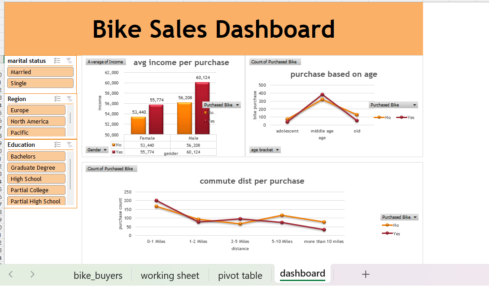

# Excel Business Analytics Portfolio

Welcome to my Excel analytics workspace! As an MSc IT graduate, this repository contains end-to-end data processing pipelines, structured data transformations, and interactive dashboards built completely inside Microsoft Excel.

## 📂 Project Showcase: Bike Buyers Purchase Analytics
- **Objective:** Transformed a raw customer demographic spreadsheet into an interactive dashboard to analyze the core drivers behind bicycle purchase decisions.
- **Core Visuals Engineered:** 
  - **Income Distribution Patterns:** Analyzed how average customer income levels impact bike purchases across genders.
  - **Commute Distance Dynamics:** Tracked customer purchase trends relative to their daily travel distances.
  - **Age Group Demographics:** Structured custom brackets to isolate purchase behaviors among Middle-Aged, Adolescent, and Senior customer segments.
  - **Operational Filters (Slicers):** Embedded interactive panels tracking Marital Status, Region, and Education to dynamically filter metrics.
    
## Dashboard visual interface

